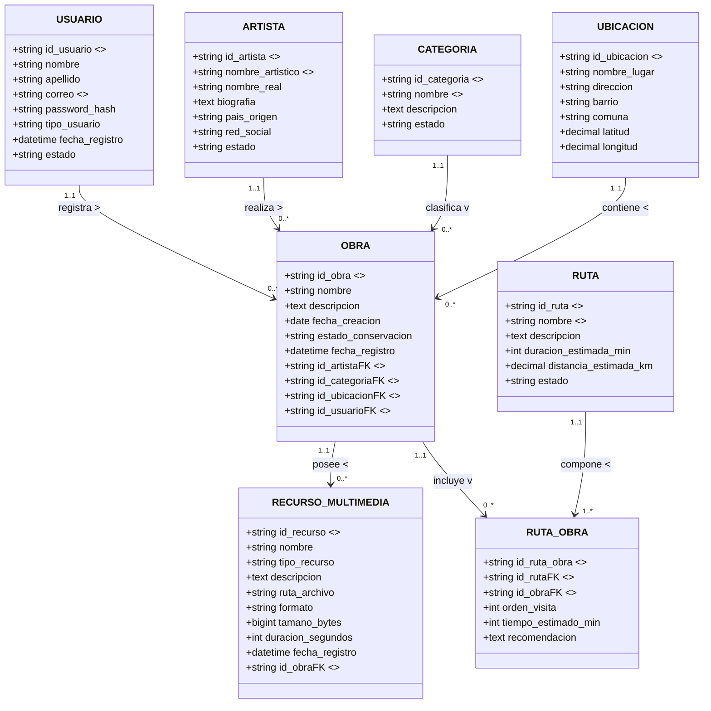

# Galería de Arte Urbano de Cali
## Documento Técnico — Etapa 2: Diseño Conceptual UML (Modelo Entidad–Relación)

**Asignatura:** Bases de Datos Multimedia (BDM)  
**Institución:** Universidad Autónoma de Occidente (UAO) — Facultad de Ingeniería  
**Docente:** David Alejandro Castro Benavides  
**Integrantes del Grupo:**
* Juan Pablo Campo Bertin
* Jean Deiby Garcia  
**Versión:** 1.0  
**Fecha:** Septiembre de 2026  
**Archivos Asociados:**
* Diagrama UMLet portable: [`Galeria_Arte_Urbano_Cali_MER.uxf`](file:///C:/Users/Pablito/Documents/Bases%20de%20Datos/08_Proyecto_Semestre_Galeria_Arte_Urbano/Galeria_Arte_Urbano_Cali_MER.uxf)
* Diagrama Vectorial de Alta Resolución: [`Galeria_Arte_Urbano_Cali_MER.svg`](file:///C:/Users/Pablito/Documents/Bases%20de%20Datos/08_Proyecto_Semestre_Galeria_Arte_Urbano/Galeria_Arte_Urbano_Cali_MER.svg)

---

## 1. Introducción y Notación Utilizada

La presente etapa formaliza el diseño conceptual del sistema para la **Galería de Arte Urbano de Cali** mediante la notación estándar de clases y relaciones de UML (trabajada en la herramienta UMLet), cumpliendo con las directrices académicas y pedagógicas de la asignatura:

1. **Notación de Atributos:** Identificadores con estereotipo `<<PK>>`, atributos obligatorios y opcionales con multiplicidad `[0..1]`, y claves foráneas con estereotipo `<<FK>>`.
2. **Cardinalidades en Ambos Extremos:** Se especifican las restricciones de multiplicidad en notación `min..max` (`1..1`, `0..*`, `1..*`).
3. **Verbos de Relación y Sentido de Lectura:** Cada asociación incluye su nombre formal y la flecha indicadora de la dirección semántica de lectura (`>`, `<`, `v`).
4. **Resolución de Relaciones Muchos a Muchos:** Implementación estricta de la entidad asociativa `RUTA_OBRA` para la relación entre `RUTA` y `OBRA`.

---

## 2. Diagrama Conceptual UML (Representación Mermaid)

---

## 3. Especificación Técnica de las 8 Entidades

### 3.1. `USUARIO`
* **Propósito:** Control de acceso, perfiles y trazabilidad de operaciones.
* **Atributos:**
  - `id_usuario : string <<PK>>`: UUID v4 de 36 caracteres.
  - `nombre : string`, `apellido : string`: Datos personales del usuario.
  - `correo : string <<UNIQUE>>`: Identificador de inicio de sesión.
  - `password_hash : string`: Hash seguro (BCrypt/SHA-256) de la contraseña.
  - `tipo_usuario : string`: Rol (`'ADMINISTRADOR'` o `'VISITANTE'`).
  - `fecha_registro : datetime`: Auditoría de alta en el sistema.
  - `estado : string`: Control de actividad de la cuenta (`'ACTIVO'`, `'INACTIVO'`).

### 3.2. `ARTISTA`
* **Propósito:** Registro de los creadores de arte urbano.
* **Atributos:**
  - `id_artista : string <<PK>>`: UUID v4.
  - `nombre_artistico : string <<UNIQUE>>`: Seudónimo o firma pública del artista.
  - `nombre_real : string [0..1]`: Nombre legal opcional.
  - `biografia : text [0..1]`: Trayectoria artística.
  - `pais_origen : string`: País de procedencia.
  - `red_social : string [0..1]`: Enlace al portafolio digital.
  - `estado : string`: Borrado lógico (`'ACTIVO'`, `'INACTIVO'`).

### 3.3. `CATEGORIA`
* **Propósito:** Taxonomía de las técnicas y expresiones urbanas.
* **Atributos:**
  - `id_categoria : string <<PK>>`: UUID v4.
  - `nombre : string <<UNIQUE>>`: Denominación (`Mural`, `Grafiti`, `Stencil`, `Retrato`, `Arte Tipográfico`).
  - `descripcion : text [0..1]`: Definición de la técnica.
  - `estado : string`: Habilitación en formularios.

### 3.4. `UBICACION`
* **Propósito:** Georreferenciación y emplazamiento físico en Cali.
* **Atributos:**
  - `id_ubicacion : string <<PK>>`: UUID v4.
  - `nombre_lugar : string`: Sector o hito (ej. "Bulevar del Río").
  - `direccion : string`: Nomenclatura urbana.
  - `barrio : string`, `comuna : string`: Zonificación administrativa de Cali.
  - `latitud : decimal(10,8)`, `longitud : decimal(11,8)`: Coordenadas GPS validadas por `CHECK`.

### 3.5. `OBRA` (Entidad Núcleo)
* **Propósito:** Registro central de las piezas de arte público.
* **Atributos:**
  - `id_obra : string <<PK>>`: UUID v4.
  - `nombre : string`: Nombre de la obra.
  - `descripcion : text`: Reseña conceptual del mural.
  - `fecha_creacion : date [0..1]`: Fecha de pintura/ejecución.
  - `estado_conservacion : string`: Estado físico (`EXCELENTE`, `BUENO`, `DETERIORADO`, `DESTRUIDO`).
  - `fecha_registro : datetime`: Registro de inserción.
  - `id_artistaFK : string <<FK>>`: Llave foránea al artista creador.
  - `id_categoriaFK : string <<FK>>`: Llave foránea a la categoría.
  - `id_ubicacionFK : string <<FK>>`: Llave foránea al lugar físico.
  - `id_usuarioFK : string <<FK>>`: Llave foránea al usuario registrador.

### 3.6. `RECURSO_MULTIMEDIA`
* **Propósito:** Catálogo de activos digitales asociados a la obra.
* **Atributos:**
  - `id_recurso : string <<PK>>`: UUID v4.
  - `nombre : string`: Título descriptivo del archivo.
  - `tipo_recurso : string`: `'IMAGEN'`, `'VIDEO'`, `'AUDIO'`, `'MODELO_3D'`, `'AR'`.
  - `descripcion : text [0..1]`: Contexto del recurso.
  - `ruta_archivo : string`: **Ruta relativa** en disco (`RecursosMultimedia/...`).
  - `formato : string`: Extensión estandarizada (`JPG`, `PNG`, `MP4`, `MP3`, `GLB`).
  - `tamano_bytes : bigint`: Peso del archivo.
  - `duracion_segundos : int [0..1]`: Duración de audio/video.
  - `fecha_registro : datetime`: Fecha de subida.
  - `id_obraFK : string <<FK>>`: Llave foránea a la obra propietaria.

### 3.7. `RUTA`
* **Propósito:** Circuitos turísticos que agrupan obras.
* **Atributos:**
  - `id_ruta : string <<PK>>`: UUID v4.
  - `nombre : string <<UNIQUE>>`: Nombre de la ruta.
  - `descripcion : text`: Perfil del recorrido.
  - `duracion_estimada_min : int`: Duración en minutos.
  - `distancia_estimada_km : decimal(5,2)`: Recorrido en km.
  - `estado : string`: Estado operativo (`ACTIVO`, `INACTIVO`).

### 3.8. `RUTA_OBRA` (Entidad Asociativa)
* **Propósito:** Resuelve la relación N:M entre `RUTA` y `OBRA`.
* **Atributos:**
  - `id_ruta_obra : string <<PK>>`: UUID v4.
  - `id_rutaFK : string <<FK>>`: Llave foránea a la ruta.
  - `id_obraFK : string <<FK>>`: Llave foránea a la obra.
  - `orden_visita : int`: Posición en la ruta ($1, 2, 3 \dots$).
  - `tiempo_estimado_min : int`: Tiempo sugerido frente a la obra.
  - `recomendacion : text [0..1]`: Consejo para el visitante.

---

## 4. Análisis de Ciclos y Relaciones de Redundancia

Durante el diseño se evaluó la presencia de posibles ciclos cerrados entre entidades:
1. **Verificación Usuario — Obra — Artista:**
   - Un usuario registra una obra (`USUARIO 1..1 -> 0..* OBRA`).
   - Un artista realiza la obra (`ARTISTA 1..1 -> 0..* OBRA`).
   - **Decisión de diseño:** No se estableció una relación directa entre `USUARIO` y `ARTISTA`. Esto evita crear un ciclo triangular cerrado (`USUARIO` $\to$ `ARTISTA` $\to$ `OBRA` $\to$ `USUARIO`) que provocaría ambigüedad en las reglas de propagación y redundancia referencial.
2. **Verificación Ruta — Obra — Ubicación:**
   - Una ruta se compone de obras mediante `RUTA_OBRA`.
   - Cada obra tiene su propia `UBICACION`.
   - La ruta **no** se vincula directamente a `UBICACION`, ya que la ubicación geográfica de la ruta se infiere de forma natural y transitiva a partir de las obras que la componen, evitando redundancias en la base de datos.
3. **Desacoplamiento Multimedia:**
   - `RECURSO_MULTIMEDIA` se asocia exclusivamente a `OBRA`. No existe vínculo directo con `ARTISTA` ni con `USUARIO`, garantizando un grafo de relaciones estrictamente jerárquico y acíclico hacia las hojas del modelo.

---

## 5. Instrucciones de Visualización y Edición en UMLet

El archivo fuente [`Galeria_Arte_Urbano_Cali_MER.uxf`](file:///C:/Users/Pablito/Documents/Bases%20de%20Datos/08_Proyecto_Semestre_Galeria_Arte_Urbano/Galeria_Arte_Urbano_Cali_MER.uxf) ha sido generado con compatibilidad nativa para **UMLet 15.0**:
1. Abre UMLet (usando el archivo portable ubicado en [`00_Recursos_y_Teoria_General/Herramientas/umlet-standalone-15.0.0.zip`](file:///C:/Users/Pablito/Documents/Bases%20de%20Datos/00_Recursos_y_Teoria_General/Herramientas/umlet-standalone-15.0.0.zip)).
2. En el menú superior: `File` $\to$ `Open...` $\to$ seleccionar `Galeria_Arte_Urbano_Cali_MER.uxf`.
3. Todos los elementos están alineados sobre una cuadrícula limpia sin líneas cruzadas.
