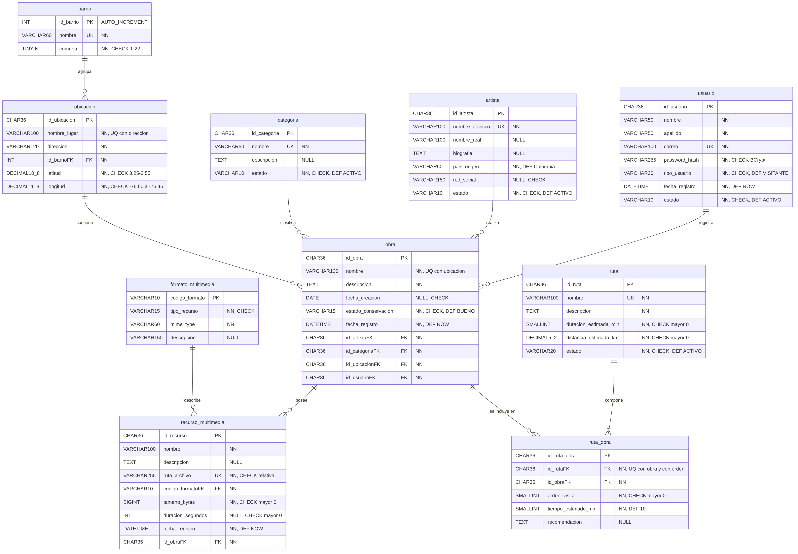

# Galería de Arte Urbano de Cali
## Documento Técnico — Etapa 4: Modelo Relacional de Datos (MRD)

**Asignatura:** Bases de Datos Multimedia (BDM)  
**Institución:** Universidad Autónoma de Occidente (UAO) — Facultad de Ingeniería  
**Docente:** David Alejandro Castro Benavides  
**Integrantes del Grupo:**
* Juan Pablo Campo Bertin
* Jean Deiby Garcia  
**Versión:** 1.0  
**Fecha:** Noviembre de 2026  
**Archivos asociados:** `MRD_Galeria_Arte_Urbano.png` (diagrama), `MRD_Galeria_Arte_Urbano.mmd` (fuente Mermaid), `../Etapa_5_MySQL/01_estructura.sql` (implementación)

---

## 1. Del modelo conceptual al modelo relacional

El MRD traduce el diseño UML normalizado (Etapa 3) a **tablas** que MySQL puede crear. Se aplicaron estas reglas de transformación:

| Regla | Qué se hace | Dónde se aplicó |
|---|---|---|
| R1. Entidad → tabla | Cada entidad pasa a ser una tabla; su identificador pasa a ser la **PK** | Las 10 entidades |
| R2. Relación 1:N → FK en el lado N | La tabla del lado "muchos" recibe una columna FK que apunta a la PK del lado "uno" | `obra` (4 FK), `ubicacion`, `recurso_multimedia` (2 FK) |
| R3. Relación M:N → tabla asociativa | Se crea una tabla con una FK hacia cada lado más los atributos propios de la relación | `ruta_obra` (Ruta–Obra) |
| R4. Atributo `[0..1]` → `NULL` | Los atributos opcionales del UML admiten nulos; los obligatorios son `NOT NULL` | `nombre_real`, `biografia`, `fecha_creacion`, etc. |
| R5. Cardinalidad mínima 1 en el lado "uno" → FK `NOT NULL` | Si cada obra debe tener artista (`1..1`), la FK no admite nulos | Todas las FK |

**Convenciones de nombres**

* Tablas en minúscula y `snake_case` (`recurso_multimedia`). MySQL en Windows convierte los nombres de tabla a minúscula; usarlos así desde el principio evita errores al llevar el proyecto entre Windows y Linux.
* Las FK conservan el sufijo `FK` usado en las Etapas 1 y 2 (`id_artistaFK`) para mantener la coherencia entre documentos.
* Restricciones con prefijo: `pk_` (llave primaria), `fk_` (foránea), `uq_` (única), `ck_` (CHECK). Así los mensajes de error de MySQL dicen exactamente qué regla se violó (ej. `Check constraint 'ck_ubicacion_latitud' is violated`).

**Decisiones de tipos de datos que aplican a todas las tablas**

| Decisión | Justificación |
|---|---|
| UUID como `CHAR(36)` con `DEFAULT (UUID())` | El enunciado exige UUID en las entidades principales. `CHAR` (longitud fija) es más eficiente que `VARCHAR` cuando todos los valores miden lo mismo. El `DEFAULT` permite insertar sin enviar el id; la aplicación C# igualmente lo genera con `Guid.NewGuid()` para conocerlo antes de insertar |
| Catálogos con clave propia no UUID | `barrio.id_barrio` es `INT AUTO_INCREMENT` y `formato_multimedia.codigo_formato` es una clave natural (`'JPG'`). Son tablas de apoyo pequeñas, no "entidades principales"; una clave natural corta hace legibles las consultas y el script |
| Dominios con `VARCHAR` + `CHECK` en lugar de `ENUM` | El `CHECK` es estándar SQL, muestra la regla explícitamente y su mensaje de error es claro. `ENUM` es exclusivo de MySQL |
| `utf8mb4` + `utf8mb4_0900_ai_ci` | Soporta tildes, ñ y emojis. La intercalación `ai` (*accent insensitive*) hace que `'Grafiti'` y `'Grafíti'` choquen con el `UNIQUE`, evitando duplicados por tildes |
| `DECIMAL` para coordenadas y distancias | `FLOAT/DOUBLE` son aproximados; `DECIMAL(10,8)` guarda la latitud exacta con 8 decimales (≈ 1 mm de precisión) |
| `UNSIGNED` en cantidades | Tamaños, duraciones y órdenes nunca son negativos; además duplica el rango positivo |
| Motor `InnoDB` | Es el único motor de MySQL que hace cumplir las llaves foráneas y soporta transacciones |

---

## 2. Diagrama del modelo relacional

Lectura de los símbolos (notación pata de gallo): `||` = exactamente uno, `o{` = cero o muchos, `|{` = uno o muchos.

---

## 3. Especificación de cada tabla

Abreviaturas: **PK** llave primaria · **FK** llave foránea · **UQ** única · **NN** NOT NULL · **DEF** valor por defecto.

### 3.1 `usuario`

| Columna | Tipo | Restricciones | Comentario |
|---|---|---|---|
| `id_usuario` | CHAR(36) | **PK**, NN, DEF `UUID()` | |
| `nombre` | VARCHAR(50) | NN, CHECK no vacío | |
| `apellido` | VARCHAR(50) | NN, CHECK no vacío | |
| `correo` | VARCHAR(100) | NN, **UQ**, CHECK formato `%_@_%._%` | Se usa para iniciar sesión |
| `password_hash` | VARCHAR(255) | NN, CHECK formato BCrypt | El CHECK rechaza cualquier valor que no sea un hash BCrypt de 60 caracteres: **la BD impide guardar contraseñas en texto plano** (regla 7) |
| `tipo_usuario` | VARCHAR(20) | NN, CHECK (`ADMINISTRADOR`,`VISITANTE`), DEF `VISITANTE` | Por defecto el permiso mínimo |
| `fecha_registro` | DATETIME | NN, DEF `CURRENT_TIMESTAMP` | |
| `estado` | VARCHAR(10) | NN, CHECK (`ACTIVO`,`INACTIVO`), DEF `ACTIVO` | Un usuario inactivo no puede iniciar sesión |

### 3.2 `artista`

| Columna | Tipo | Restricciones | Comentario |
|---|---|---|---|
| `id_artista` | CHAR(36) | **PK**, NN, DEF `UUID()` | |
| `nombre_artistico` | VARCHAR(100) | NN, **UQ**, CHECK no vacío | Dos artistas no comparten firma |
| `nombre_real` | VARCHAR(100) | NULL | Muchos artistas urbanos no lo revelan |
| `biografia` | TEXT | NULL | |
| `pais_origen` | VARCHAR(60) | NN, DEF `'Colombia'` | La mayoría son locales |
| `red_social` | VARCHAR(150) | NULL, CHECK empieza por `http` o `@` | Evita textos que no sean enlace o usuario |
| `estado` | VARCHAR(10) | NN, CHECK, DEF `ACTIVO` | Borrado lógico (RN-02) |

### 3.3 `categoria`

| Columna | Tipo | Restricciones |
|---|---|---|
| `id_categoria` | CHAR(36) | **PK**, NN, DEF `UUID()` |
| `nombre` | VARCHAR(50) | NN, **UQ**, CHECK no vacío |
| `descripcion` | TEXT | NULL |
| `estado` | VARCHAR(10) | NN, CHECK (`ACTIVO`,`INACTIVO`), DEF `ACTIVO` |

### 3.4 `barrio` *(nueva — 3FN-6)*

| Columna | Tipo | Restricciones | Comentario |
|---|---|---|---|
| `id_barrio` | INT UNSIGNED | **PK**, AUTO_INCREMENT | Catálogo |
| `nombre` | VARCHAR(60) | NN, **UQ** | |
| `comuna` | TINYINT UNSIGNED | NN, CHECK `BETWEEN 1 AND 22` | Cali tiene 22 comunas urbanas |

### 3.5 `ubicacion`

| Columna | Tipo | Restricciones | Comentario |
|---|---|---|---|
| `id_ubicacion` | CHAR(36) | **PK**, NN, DEF `UUID()` | |
| `nombre_lugar` | VARCHAR(100) | NN, CHECK no vacío | |
| `direccion` | VARCHAR(120) | NN | `UQ (nombre_lugar, direccion)` evita registrar dos veces el mismo sitio |
| `id_barrioFK` | INT UNSIGNED | NN, **FK** → `barrio` | Reemplaza a `barrio` y `comuna` (3FN-5) |
| `latitud` | DECIMAL(10,8) | NN, CHECK `BETWEEN 3.25 AND 3.55` | RN-06 |
| `longitud` | DECIMAL(11,8) | NN, CHECK `BETWEEN -76.60 AND -76.45` | RN-06 |

### 3.6 `obra`

| Columna | Tipo | Restricciones | Comentario |
|---|---|---|---|
| `id_obra` | CHAR(36) | **PK**, NN, DEF `UUID()` | |
| `nombre` | VARCHAR(120) | NN, CHECK no vacío | `UQ (id_ubicacionFK, nombre)`: no hay dos obras con el mismo nombre en el mismo lugar |
| `descripcion` | TEXT | NN | |
| `fecha_creacion` | DATE | NULL, CHECK `>= 1950-01-01` y `<= fecha_registro` | No puede ser futura respecto al registro |
| `estado_conservacion` | VARCHAR(15) | NN, CHECK (`EXCELENTE`,`BUENO`,`DETERIORADO`,`DESTRUIDO`), DEF `BUENO` | |
| `fecha_registro` | DATETIME | NN, DEF `CURRENT_TIMESTAMP` | |
| `id_artistaFK` | CHAR(36) | NN, **FK** → `artista` | RN-01 |
| `id_categoriaFK` | CHAR(36) | NN, **FK** → `categoria` | RN-01 |
| `id_ubicacionFK` | CHAR(36) | NN, **FK** → `ubicacion` | RN-01 |
| `id_usuarioFK` | CHAR(36) | NN, **FK** → `usuario` | Trazabilidad |

> MySQL no permite `CHECK (fecha_creacion <= CURDATE())` porque `CURDATE()` cambia cada día (no es determinista). Por eso se compara con `fecha_registro`, y la aplicación C# valida además que la fecha no sea futura.

### 3.7 `formato_multimedia` *(nueva — 3FN-8)*

| Columna | Tipo | Restricciones | Comentario |
|---|---|---|---|
| `codigo_formato` | VARCHAR(10) | **PK**, CHECK en mayúscula | `JPG`, `PNG`, `MP4`, `MP3`, `GLB`, `AR` |
| `tipo_recurso` | VARCHAR(15) | NN, CHECK (`IMAGEN`,`VIDEO`,`AUDIO`,`MODELO_3D`,`AR`) | |
| `mime_type` | VARCHAR(60) | NN | Ej. `image/jpeg`; útil para abrir el archivo correctamente |
| `descripcion` | VARCHAR(150) | NULL | |

### 3.8 `recurso_multimedia`

| Columna | Tipo | Restricciones | Comentario |
|---|---|---|---|
| `id_recurso` | CHAR(36) | **PK**, NN, DEF `UUID()` | |
| `nombre` | VARCHAR(100) | NN | |
| `descripcion` | TEXT | NULL | |
| `ruta_archivo` | VARCHAR(255) | NN, **UQ**, CHECK ruta relativa | El CHECK rechaza `C:\...`, rutas que empiezan por `/` o `\` y rutas con `..`. Así **la BD garantiza** que la ruta es relativa a `RecursosMultimedia/` |
| `codigo_formatoFK` | VARCHAR(10) | NN, **FK** → `formato_multimedia` | Solo formatos permitidos |
| `tamano_bytes` | BIGINT UNSIGNED | NN, CHECK `> 0` | `BIGINT`: un video puede pasar de 2 GB (límite de `INT`) |
| `duracion_segundos` | INT UNSIGNED | NULL, CHECK `NULL OR > 0` | Solo audio y video (validado en C#) |
| `fecha_registro` | DATETIME | NN, DEF `CURRENT_TIMESTAMP` | |
| `id_obraFK` | CHAR(36) | NN, **FK** → `obra` | |

### 3.9 `ruta`

| Columna | Tipo | Restricciones |
|---|---|---|
| `id_ruta` | CHAR(36) | **PK**, NN, DEF `UUID()` |
| `nombre` | VARCHAR(100) | NN, **UQ** |
| `descripcion` | TEXT | NN |
| `duracion_estimada_min` | SMALLINT UNSIGNED | NN, CHECK `> 0` |
| `distancia_estimada_km` | DECIMAL(5,2) | NN, CHECK `> 0` (máx. 999.99 km) |
| `estado` | VARCHAR(20) | NN, CHECK (`ACTIVO`,`INACTIVO`,`EN_MANTENIMIENTO`), DEF `ACTIVO` |

### 3.10 `ruta_obra` *(asociativa — resuelve la M:N Ruta–Obra)*

| Columna | Tipo | Restricciones | Comentario |
|---|---|---|---|
| `id_ruta_obra` | CHAR(36) | **PK**, NN, DEF `UUID()` | Ver justificación en Etapa 3, §4.4 |
| `id_rutaFK` | CHAR(36) | NN, **FK** → `ruta` | |
| `id_obraFK` | CHAR(36) | NN, **FK** → `obra` | |
| `orden_visita` | SMALLINT UNSIGNED | NN, CHECK `> 0` | |
| `tiempo_estimado_min` | SMALLINT UNSIGNED | NN, CHECK `> 0`, DEF `10` | |
| `recomendacion` | TEXT | NULL | |
| | | **UQ (`id_rutaFK`, `id_obraFK`)** | Una obra no se repite en la misma ruta |
| | | **UQ (`id_rutaFK`, `orden_visita`)** | El orden no se repite en la misma ruta (regla 5) |

**Relación M:N completamente resuelta:** `ruta 1 —< ruta_obra >— 1 obra`. Ninguna tabla guarda listas de obras ni listas de rutas.

---

## 4. Reglas de eliminación y actualización de cada FK

`ON DELETE` define qué pasa con las filas hijas cuando se intenta borrar la fila padre. `ON UPDATE` define qué pasa si cambia la PK del padre.

| # | FK (hija → padre) | ON DELETE | ON UPDATE | Justificación |
|---|---|---|---|---|
| 1 | `obra.id_artistaFK` → `artista` | **RESTRICT** | CASCADE | RN-02: un artista con obras no se borra; se desactiva (`sp_eliminar_o_desactivar_artista`). Borrar en cascada destruiría el patrimonio registrado |
| 2 | `obra.id_categoriaFK` → `categoria` | **RESTRICT** | CASCADE | Una categoría en uso no puede desaparecer; se marca `INACTIVO` y deja de aparecer en los formularios |
| 3 | `obra.id_ubicacionFK` → `ubicacion` | **RESTRICT** | CASCADE | RN-01: toda obra debe tener ubicación. `SET NULL` es imposible porque la columna es NOT NULL |
| 4 | `obra.id_usuarioFK` → `usuario` | **RESTRICT** | CASCADE | Se conserva la trazabilidad de quién registró la obra; los usuarios se desactivan, no se borran |
| 5 | `ubicacion.id_barrioFK` → `barrio` | **RESTRICT** | CASCADE | No se borra un barrio que tenga ubicaciones |
| 6 | `recurso_multimedia.codigo_formatoFK` → `formato_multimedia` | **RESTRICT** | CASCADE | No se puede quitar un formato mientras haya archivos de ese formato. `ON UPDATE CASCADE` sí tiene sentido aquí porque la PK es un código legible que podría corregirse (ej. `JPEG` → `JPG`) |
| 7 | `recurso_multimedia.id_obraFK` → `obra` | **CASCADE** | CASCADE | Regla 2: un recurso no existe sin su obra. Si un administrador elimina una obra, sus registros multimedia se eliminan con ella (la app borra también los archivos del disco) |
| 8 | `ruta_obra.id_rutaFK` → `ruta` | **CASCADE** | CASCADE | Si se elimina una ruta, sus paradas pierden sentido; las obras **no** se borran, solo su participación en esa ruta |
| 9 | `ruta_obra.id_obraFK` → `obra` | **RESTRICT** | CASCADE | Si se pudiera borrar una obra que está en una ruta, la ruta quedaría con un hueco en el orden (1, 2, 4...). Se obliga a retirarla primero con `sp_retirar_obra_de_ruta`, que reordena las paradas |

> **¿Por qué `ON UPDATE CASCADE` si los UUID no cambian?** En la práctica no se actualizan, pero declararlo documenta la intención y no tiene costo. Es la opción segura si alguna vez hay que corregir una clave.

> **Limitación de MySQL a tener en cuenta:** una columna que participa en una FK con acción `CASCADE`/`SET NULL` no puede usarse en un `CHECK`. Por eso los `CHECK` se pusieron solo en columnas que no son FK.

---

## 5. Restricciones de integridad: resumen

| Tipo | Cantidad | Ejemplos |
|---|---|---|
| PRIMARY KEY | 10 | una por tabla |
| FOREIGN KEY | 9 | ver sección 4 |
| UNIQUE | 10 | `correo`, `nombre_artistico`, `(id_rutaFK, orden_visita)`, `ruta_archivo`... |
| CHECK | 29 | coordenadas, dominios, hash BCrypt, ruta relativa, valores positivos |
| DEFAULT | 19 | UUID, fechas actuales, estados `ACTIVO`, `tiempo_estimado_min = 10` |

Reglas que **no** se pueden expresar solo con restricciones de tabla y dónde se garantizan:

| Regla | Dónde se garantiza |
|---|---|
| Orden de visita consecutivo sin huecos (1, 2, 3...) | Procedimientos `sp_agregar_obra_a_ruta`, `sp_retirar_obra_de_ruta`, `sp_mover_obra_en_ruta` |
| Artista con obras se desactiva en vez de borrarse | FK `RESTRICT` + `sp_eliminar_o_desactivar_artista` |
| `duracion_segundos` solo en audio/video | Capa de negocio C# (`RecursoService`) |
| Fecha de creación no futura | Capa de negocio C# + CHECK contra `fecha_registro` |
| El archivo existe realmente en disco | Aplicación C# (verifica antes de registrar y antes de abrir) |
